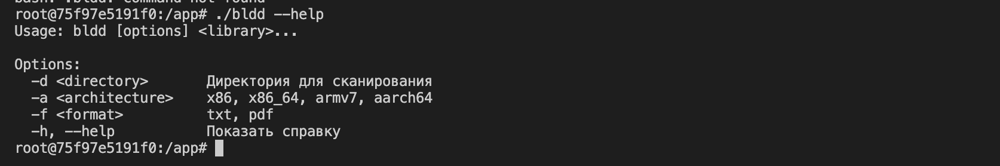
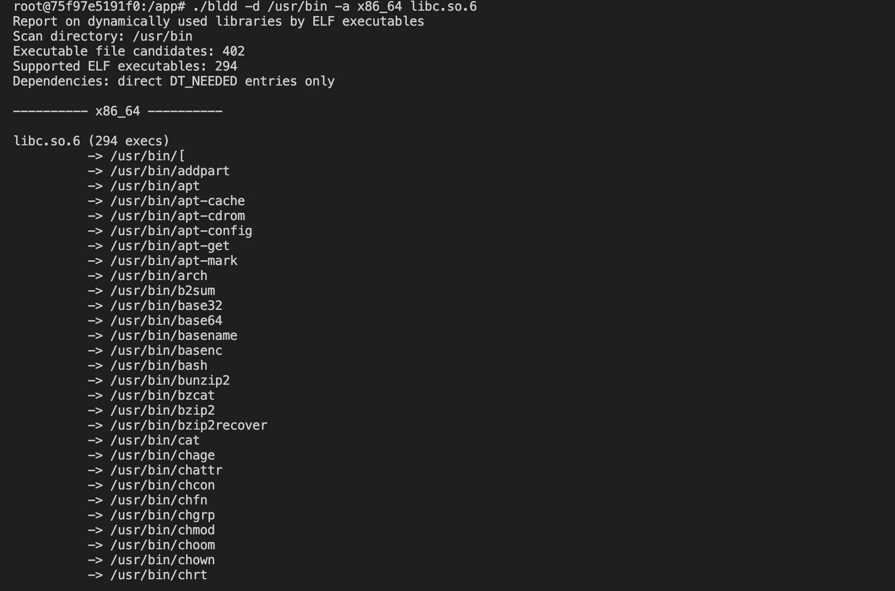

# bldd — обратный ldd

Лабораторная работа №1 по продвинутому Linux. Программа написана на **C** и ищет исполняемые ELF-файлы, которые используют указанные разделяемые библиотеки.

Обычный `ldd` показывает библиотеки одной программы. В `bldd` поиск идет в обратную сторону: передаем библиотеку, указываем каталог и получаем список программ, у которых она находится среди зависимостей.

## 1. Задание и цель

Нужно было сделать утилиту, которая:

- сканирует выбранную директорию и вложенные папки;
- проверяет исполняемые ELF-файлы;
- находит программы, использующие заданные библиотеки;
- различает **x86, x86_64, armv7, aarch64**;
- сохраняет отчет, сгруппированный по архитектурам и отсортированный по количеству использований;
- поддерживает аргументы командной строки и `--help` с примерами.

Цель работы — разобраться, как в ELF хранятся динамические зависимости и как их можно читать без запуска программы.

## 2. Сборка

Проект рассчитан на Linux. Используются `gcc`, `make` и `libelf` (elfutils):

```bash
sudo apt update
sudo apt install build-essential libelf-dev
make
```

В результате появится исполняемый файл `bldd`. Объектные файлы складываются в `build/`.

Полезные команды:

```bash
make                 # собрать программу
make samples         # скачать тестовые бинарники в execs/
make clean           # удалить результаты сборки
make clean-samples   # удалить скачанные тестовые бинарники
```

Для `make samples` используется репозиторий [binary-samples](https://github.com/JonathanSalwan/binary-samples). Директория `execs/` добавлена в `.gitignore`.

## 3. Сборка и запуск в Docker

При работе на другой ОС удобнее собирать и запускать `bldd` в Linux-контейнере. Для этого в корне проекта есть `Dockerfile`.

Собрать Docker-образ (вместе с программой):

```bash
docker build -t bldd .
```

Запустить поиск по `/usr/bin` **внутри контейнера** и сохранить отчет на компьютере:

```bash
mkdir -p reports

docker run --rm \
  -v "$PWD/reports:/output" \
  bldd -d /usr/bin libc.so.6
```

После завершения в `reports/report.txt` будет отчет. Папка `reports/` монтируется в контейнер как `/output`, потому что утилита записывает `report.txt` в текущую рабочую директорию.

Можно просканировать и заранее скачанные ELF-примеры из `execs/`:

```bash
make samples

docker run --rm \
  -v "$PWD/execs:/samples:ro" \
  -v "$PWD/reports:/output" \
  bldd -d /samples libc.so.6
```

Здесь `:ro` означает, что тестовые файлы подключаются только для чтения. Сам `bldd` работает в Linux-контейнере, а исходники и примеры остаются на компьютере.

```bash
docker build --platform linux/amd64 -t bldd:amd64 .

docker run --rm --platform linux/amd64 \
  -v "$PWD/reports:/output" \
  bldd:amd64 -d /usr/bin -a x86_64 libc.so.6
```

Если нужна просто проверка ARM64, достаточно обычного `docker build -t bldd .` и флага `-a aarch64` (или запуска без `-a`). Для запуска нужен установленный Docker Desktop или другой работающий Docker Engine.

## 4. Запуск

```bash
./bldd [опции] <библиотека> [еще_библиотеки...]
```

| Флаг | Назначение |
| --- | --- |
| `-d <dir>` | Каталог сканирования; по умолчанию `.` |
| `-a <arch>` | Фильтр: `x86`, `x86_64`, `armv7`, `aarch64`; по умолчанию все |
| `-f txt` | Формат текстового отчета; по умолчанию `txt` |
| `-h`, `--help` | Справка и примеры |

Библиотеку можно задать **по имени**, как в `DT_NEEDED`, либо **путем к `.so`**. При передаче файла программа читает его `SONAME` и архитектуру. Имя `libc.so.6` без пути ищется среди зависимостей для всех выбранных архитектур.

```bash
# Найти программы с прямой зависимостью от libc
./bldd -d /usr/bin libc.so.6

# Ограничить архитектуру
./bldd -d /usr/bin -a x86_64 libc.so.6 libm.so.6

# Передать конкретный файл библиотеки
./bldd -d /usr/bin /lib/x86_64-linux-gnu/libc.so.6

# Проверить тестовые ELF-файлы
make samples
./bldd -d ./execs -a aarch64 libc.so.6

# Посмотреть справку
./bldd --help
```

Отчет сохраняется в **`report.txt`** в текущем рабочем каталоге. При следующем запуске он перезаписывается. При работе через Docker отчет удобнее сохранять в смонтированную папку `reports/`.

## 5. Как реализован поиск

Вместо вызова `ldd` для каждой программы я читаю таблицу зависимостей непосредственно из ELF через `libelf` и `GElf`.

Работа программы по шагам:

1. `cli` разбирает параметры, определяет каталог, архитектуру и список библиотек.
2. `matcher` создает список искомых библиотек. Если передан путь к `.so`, читает ее `SONAME` и архитектуру.
3. `scanner` проходит по каталогу через `opendir`, `readdir` и `lstat`. Сначала пропускает не-обычные файлы и файлы без бита исполнения.
4. `elf_parser` проверяет ELF, получает архитектуру из `e_machine`, отличает исполняемые файлы от обычных `.so` и читает записи **`DT_NEEDED`** из секции **`SHT_DYNAMIC`**.
5. `matcher` сравнивает зависимости с переданными библиотеками и сохраняет подходящие пути в динамический массив `LibraryResult`.
6. `report` сортирует результаты через `qsort()` и формирует `report.txt`.

**Почему это быстрее, чем много раз вызывать `ldd`:** каталог просматривается один раз, ELF-файл разбирается один раз, а целиком загружать исполняемый файл в память не нужно. Кроме того, `ldd` может запускать динамический загрузчик, а `bldd` только читает метаданные файла.

Для определения архитектуры используются значения заголовка `e_machine`:

| Архитектура | ELF class | `e_machine` |
| --- | --- | --- |
| x86 | ELF32 | `EM_386` |
| x86_64 | ELF64 | `EM_X86_64` |
| armv7 | ELF32 | `EM_ARM` |
| aarch64 | ELF64 | `EM_AARCH64` |

Для `armv7` используется признак 32-битного ARM ELF (`EM_ARM`). Конкретная версия набора инструкций ARM отдельно не определяется.

### Файлы проекта

```text
src/
├── main.c                   запуск программы
├── cli/
│   ├── cli.c                обработка флагов
│   └── cli.h
├── types/
│   └── types.h              общие структуры и enum
├── scanner/
│   ├── scanner.c            обход каталогов
│   └── scanner.h
├── elf/
│   ├── elf-parser.c         чтение ELF и DT_NEEDED
│   └── elf-parser.h
├── matcher/
│   ├── matcher.c            поиск совпадений и результаты
│   └── matcher.h
└── report/
    ├── report.c             сортировка и TXT-отчет
    └── report.h

Makefile                     сборка и команды для образцов
Dockerfile                   сборка Linux-образа
.dockerignore                файлы, исключенные из Docker-сборки
```

## 6. Проверка работы

Пример содержимого отчета для четырех архитектур:

```text
Report on dynamically used libraries by ELF executables
Scan directory: ./execs
Executable file candidates: 8
Supported ELF executables: 4
Dependencies: direct DT_NEEDED entries only

---------- x86 ----------
libsample32.so.1 (1 execs)
          -> ./execs/app32

---------- x86_64 ----------
libsample.so.1 (1 execs)
          -> ./execs/app64

---------- armv7 ----------
libsamplearm.so.1 (1 execs)
          -> ./execs/apparm

---------- aarch64 ----------
libsamplea64.so.1 (1 execs)
          -> ./execs/appa64
```





> Полный отчет вызова сохранил и приложил в файле `report.txt` [тут](docs/report.txt).

## 7. Ограничения

- **Ищутся прямые зависимости** `DT_NEEDED`. Если `app -> libA -> libB`, а у `app` нет собственной записи о `libB`, поиск по `libB` такую программу не покажет. У `ldd` список может быть шире из-за транзитивных зависимостей и разрешения библиотек загрузчиком.
- Сканер не следует за символическими ссылками, чтобы не получать циклы при обходе папок.
- Проверяются обычные файлы с битом исполнения. Скрипты (`#!/bin/sh`, Python и т. д.) не считаются ELF-программами.
- Для разбора динамических зависимостей используется таблица секций ELF (`SHT_DYNAMIC`). Нетипичные файлы без таблицы секций не поддерживаются.

## 8. Вывод

В лабораторной работе получилась утилита для поиска обратных зависимостей ELF-программ. Я разобрался с динамическими секциями ELF, `DT_NEEDED` и `SONAME`, различием ELF32/ELF64 и определением архитектуры. Для обхода файлов использовал POSIX-функции, для разбора ELF — `libelf`, а результаты сохранил в обычном динамическом массиве структур. Такой реализации достаточно для поиска прямых зависимостей без запуска исполняемых файлов.

